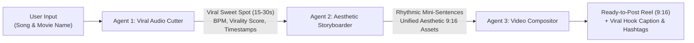

# Daily_Content_Creation_Agent 🎬✨

[](https://github.com/BhagirathArgade)
[](https://github.com/BhagirathArgade/Daily_Content_Creation_Agent)
[](LICENSE)
[](https://instagram.com)

> **Autonomous Multi-Agent AI System** engineered to create daily viral Instagram Reels, TikTok videos, and YouTube Shorts from any song and movie input. Built with a 3-agent pipeline, kinetic typography engine, unified aesthetic visual synthesis, and an advanced interactive web dashboard.

---

## 👑 Author Credit
- **Architect & Developer:** [Bhagirath Argade](https://github.com/BhagirathArgade)
- **Repository:** [`https://github.com/BhagirathArgade/Daily_Content_Creation_Agent`](https://github.com/BhagirathArgade/Daily_Content_Creation_Agent)

---

## 🧠 System Architecture: 3-Agent Collaborative Pipeline

The system is powered by three specialized AI models/agents working in a synchronous assembly line:



### 1. 🎵 Agent 1: Viral Audio & Hook Extractor
- **Role:** Pinpoints the exact 15–30 second viral sweet spot of any song.
- **Virality Engine:** Analyzes harmonic build-ups, chorus drops, and dynamic energy curves.
- **Output:** Start/end timestamps, BPM calculation, virality rating (0–100), energy level, and audio clip extraction.

### 2. 🎨 Agent 2: Lyrical Breakdown & Aesthetic Storyboarder
- **Role:** Segments the viral hook into meaningful mini-sentences and synchronized micro-timestamps.
- **Aesthetic DNA Enforcement:** Guarantees that **all scenes adhere strictly to the exact same visual tone, color grading, lighting, and camera lens style**.
- **Vibe Themes:**
  - 🌧️ *Moody Monsoon 35mm Film* (Rain-streaked neon, 35mm film grain, Wong Kar-wai color tones)
  - 🌅 *Golden Hour Nostalgia* (Kodak Portra 400 warmth, hazy sunset flares, poetic intimacy)
  - 🌆 *Cyber Lofi Midnight Neon* (Tokyo rainy neon, purple-cyan electric haze, analog VHS texture)
  - ☕ *Dark Academia Vintage* (Candlelit warmth, antique mahogany, poetic solitude)
  - 🌌 *Anime Makoto Shinkai Dream* (Ethereal twilight clouds, radiant stars, crystalline sky)
- **Asset Synthesis:** Generates generative AI prompts and retrieves high-res 9:16 vertical aesthetic imagery from the web.

### 3. 🎬 Agent 3: Kinetic Video Compositor & Content Ready Publisher
- **Role:** Composites the audio and aesthetic visual scenes into a finished 9:16 vertical Instagram Reel.
- **Kinetic Typography:** Adds animated lyric typography with customizable styles:
  - ⚡ *Kinetic Karaoke Glow* (Word-by-word pulse)
  - 🎬 *Cinematic 35mm Film Subtitle* (Centered serif)
  - 💥 *TikTok Bold Punch* (Dynamic pop-in)
  - 🖋️ *Minimalist Typewriter*
- **Instagram Growth Engine:**
  - High-converting viral hook captions
  - Multi-tier hashtag clusters (Mass reach + Aesthetic niche + Song-specific)
  - Algorithm-optimized posting time recommendations (e.g., 7:15 PM IST)

---

## 🌟 Features

- ⚡ **Interactive Web Dashboard:** Modern, glassmorphism web interface with real-time multi-agent execution tracking.
- 📱 **Real-Time 9:16 Reel Player:** Live HTML5 Canvas preview player rendering animated lyrics, Ken Burns camera zooms, and synthesized audio.
- 📥 **1-Click Reel Export:** Direct browser-based WebM/MP4 video download using WebCodecs & Canvas capture.
- 📋 **Viral Caption Hub:** Instant 1-click copy for captions, hashtags, and credits.
- 🛠️ **CLI & Python API:** Run programmatically via command line or REST API.

---

## 🚀 Quick Start Guide

### 1. Clone the Repository
```bash
git clone https://github.com/BhagirathArgade/Daily_Content_Creation_Agent.git
cd Daily_Content_Creation_Agent
```

### 2. Install Dependencies
```bash
pip install -r requirements.txt
```

### 3. Launch the Interactive Web Dashboard
```bash
python server.py
```
Open your browser at: **`http://localhost:8000`**

*(Alternatively, you can simply open `web/index.html` directly in any web browser without running a server!)*

---

## 💻 CLI Usage

You can run the multi-agent pipeline directly from the command line:

```bash
# Example 1: Kesariya from Brahmastra
python -m core.orchestrator --song "Kesariya" --movie "Brahmastra" --vibe "golden_hour"

# Example 2: Tum Hi Ho from Aashiqui 2
python -m core.orchestrator --song "Tum Hi Ho" --movie "Aashiqui 2" --vibe "moody_monsoon"

# Example 3: Output JSON payload
python -m core.orchestrator --song "Pehle Bhi Main" --movie "Animal" --json
```

---

## 📂 Repository Structure

```
Daily_Content_Creation_Agent/
├── core/
│   ├── models.py                       # Pydantic data schemas for Agent inter-communication
│   ├── agent1_viral_cutter.py          # Agent 1: Viral hook detection & audio trimming
│   ├── agent2_aesthetic_storyboarder.py# Agent 2: Lyric chunking & aesthetic visual synthesis
│   ├── agent3_video_compositor.py      # Agent 3: Video compositing & Instagram packaging
│   └── orchestrator.py                 # Multi-Agent pipeline orchestrator
├── web/
│   ├── index.html                      # Interactive web dashboard UI
│   ├── app.js                          # Canvas 9:16 reel player & agent simulation engine
│   └── style.css                       # Glassmorphism, animations & aesthetic styling
├── assets/                             # Output reels, audio clips, and scripts
├── server.py                           # Python web server & REST API
├── requirements.txt                    # Python dependencies
├── LICENSE                             # MIT License (Bhagirath Argade)
└── README.md                           # Documentation
```

---

## 📜 License
This project is licensed under the MIT License - see the [LICENSE](LICENSE) file for details.

Developed with passion by **[Bhagirath Argade](https://github.com/BhagirathArgade)**.
